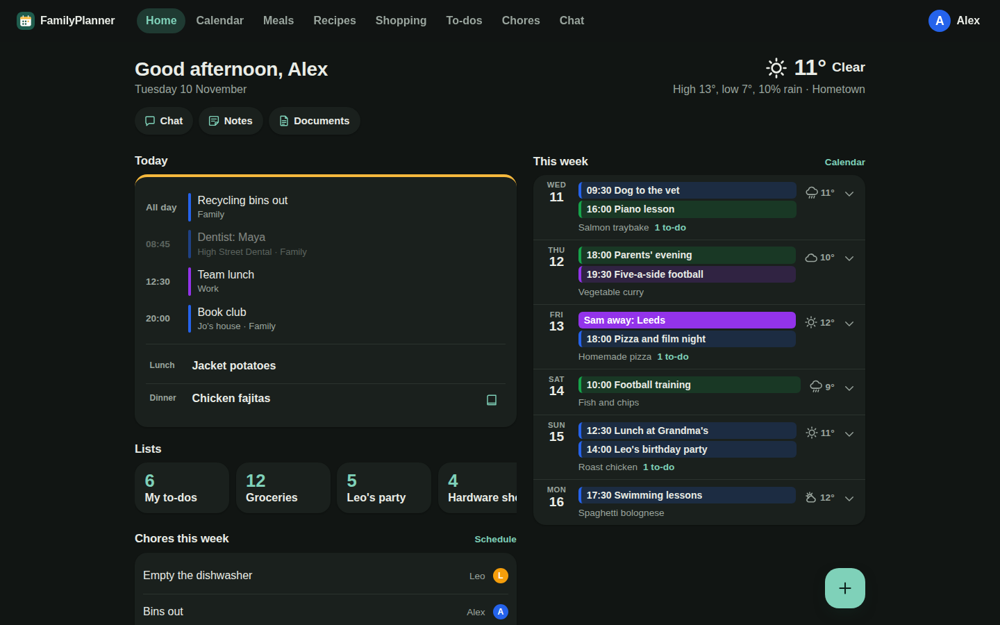
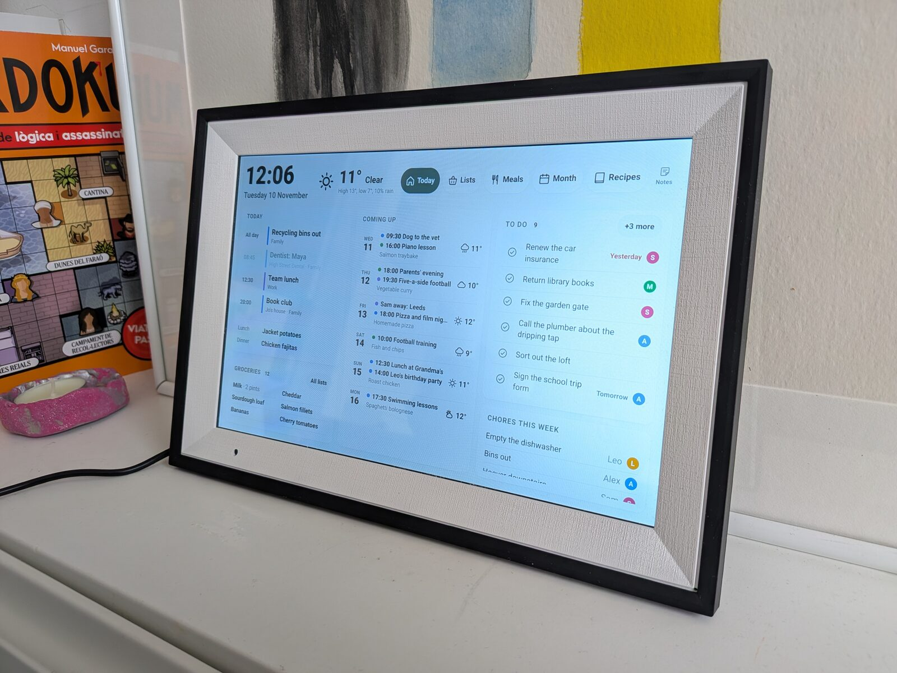
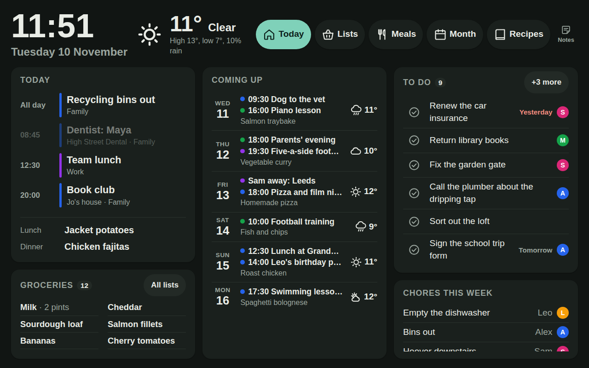
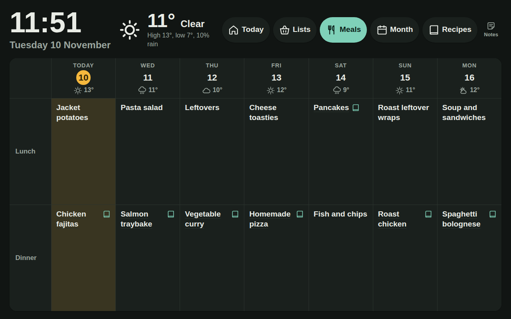
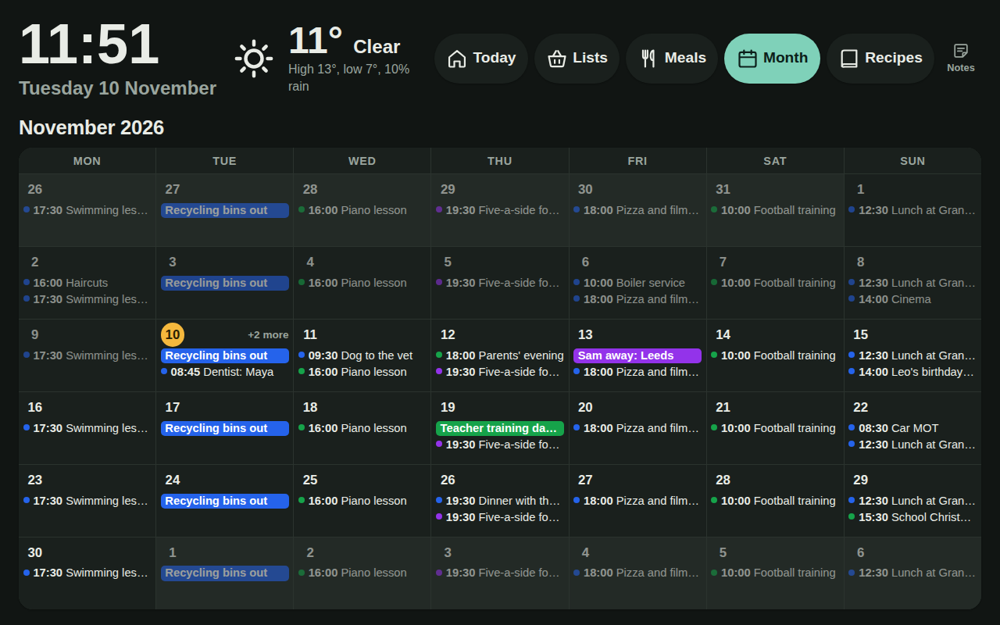
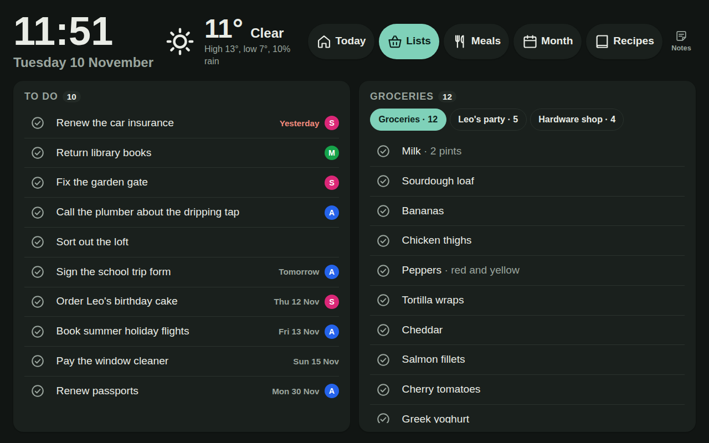
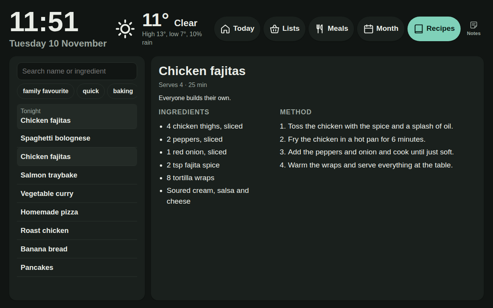
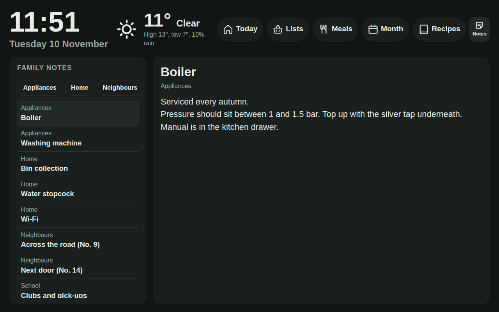

# FamilyPlanner

A small private website for one household: a view of the family's Google calendars, shopping lists, to-dos, a weekly chore schedule, a weekly meal plan, the family's recipes, family notes, a store of photographed documents, the local weather and a read-only chat assistant. See `req.md` for the full requirements. This is the v1 draft.



It also runs on a £50 photo frame on the kitchen wall ([HomeDash](https://github.com/timotaysci/HomeDash)):



The family in these images is made up: the wall has a demo mode for screenshots (see [Wall display](#wall-display)).

Write-ups: [Building a Private Family Planner](https://timothyjohnsonsci.com/writing/2026-11-06-family-planner) and [Turning a Cheap Photo Frame into a Family Wall Display](https://timothyjohnsonsci.com/writing/2026-11-06-photo-frame-wall-display).

## Layout

```
src/                  React 18 + TypeScript + Vite client (PWA)
api/                  Azure Functions v4 (Node 22, TypeScript, Zod)
  src/lib/caller.ts   the single caller-resolution function (section 6)
  src/lib/store.ts    Store interface; MemoryStore (local) and CosmosStore (Azure)
  src/lib/googleCalendars.ts   reads, caches and expands the Google calendar feeds
  src/lib/chat.ts     the chat assistant's model settings and loop
  src/lib/chatTools.ts   the read-only tools it can use
  src/handlers/       one file per feature, pure (ctx, params, query, body) => result
  src/index.ts        every route from section 10, registered in one place
infra/main.bicep      SWA + Cosmos DB free tier + role assignment + budget alert (app settings are set by CLI)
infra/set-google-calendar.sh     connects a Google calendar to the live site
infra/recipe-intake.mts, .sh     daily copy of new recipes from the org file, run by Hermes
infra/note-intake.mts, .sh       daily copy of new family notes from their org file, run by Hermes
infra/set-recipe-intake-token.sh   sets the token that job uses
infra/set-chat-key.sh            sets the Anthropic API key that turns chat on
infra/family-invites.gs          Apps Script that puts emailed invites on the Family calendar
infra/family-invites.appsscript.json   its manifest, which pins its permissions
staticwebapp.config.json   route roles, provider lockdown, security headers (Appendix A)
.github/workflows/    type-check, tests, npm audit, secret scan, deploy
```

## Run locally

Two terminals:

```
npm --prefix api run dev      # builds and starts the Functions host on :7071
npm run dev                   # Vite on :5173, proxies /api and fakes /.auth
```

Open http://localhost:5173. You start logged out. The login page offers the dev identities: Tim and Jo (admins), Charlie and Robin (members), Kitchen display (the wall screen), and Stranger (signed in but not invited, to see the not-a-member page). Switch at any time via `/.auth/dev?as=jo`.

Locally the API uses an in-memory store persisted to `api/.data/db.json`, seeded with a sample household. Delete that file to reseed. Production Cosmos DB only accepts connections from Azure datacentres (S20), so local development stays on this store.

The sample household has no events, because events only come from Google. To see some locally, add `GOOGLE_CALENDARS` to `Values` in `api/local.settings.json` in the format shown under "Connecting Google calendars". Use a public calendar's address there, because that file is committed and secret addresses must not be.

How the dev auth works: Vite's proxy injects the same `x-ms-client-principal` header that Static Web Apps injects in production, and a tiny middleware serves `/.auth/me`, `/.auth/login/aad` and `/.auth/logout`. The API has no development-only code paths.

## Tests

```
npm test            # client unit tests, then api unit tests
npm run typecheck
```

API tests cover the acceptance criteria that can be checked without a browser: A1, A2, A5, A9c, A9d, A9g, A10, A12, A13, plus clock changes, recurring events, and moved and deleted occurrences in Google feeds. They also run the parts of `infra/family-invites.gs` that need no Google services, against simulated Outlook invites.

Client tests include the org recipe parser, which is exercised with the awkward shapes from a real recipe file.

## Importing recipes

Recipes live in the app. To bring in an org file, sign in as an admin, open Settings, and choose the file under **Import recipes**. Each top-level heading becomes a recipe (see requirements section 5.8 for the format). The browser reads the file and creates the recipes through the API, so it works against the live site, which a script on a laptop can't reach (S20).

Titles the app already has are skipped, so the import can be run again after adding to the file, and it never overwrites an edit made in the app.

## Family notes

`/notes` holds the things worth having to hand: the neighbours' names, appliance model numbers, where the manuals are. It opens from the dashboard and the account menu. Any member can add and edit notes, and a web address in a note becomes a link. A note can have one photo, such as an appliance's programme chart, added in its editor; it shows under the note's text and opens full screen when tapped. The wall display shows notes read-only, photos included. Photos are added in the app; the org import brings text only.

Notes come from an org file the same way recipes do. One note per top-level heading; the category is the heading's `:CATEGORY:` property, else its first tag; everything under the heading is the note, with subheadings as `Heading:` lines and other properties as `Name: value` lines:

```org
* Washing machine :Appliances:
:PROPERTIES:
:MODEL: Acme WM-1200
:END:
Filter is behind the flap, bottom right.
[[https://example.com/wan28.pdf][Manual]]

* Neighbours :Neighbours:
** No. 12
Sam and Alex, cat called Biscuit
** No. 16
Mrs Patel, has our spare key
```

To bring a file in by hand, choose it under **Import family notes** in Settings. For a daily copy, have Hermes run `infra/note-intake.sh`, which reads `~/Dropbox/org/resources/family-notes.org` (override with `NOTE_FILE`) and posts new titles to `/api/integration/notes`. It uses the recipe intake's address and token from `~/.hermes/recipe_intake.env`, so no new token is needed. As with recipes, titles already in the app are skipped, so a note edited in the app is never overwritten, and a change made later in the org file doesn't reach the app.

## Documents

`/documents` keeps photographed paperwork: letters, warranties, certificates. On a phone, **Add** opens the camera, the photo library or the phone's files, so a PDF can be added too: each of its pages becomes a page image in the browser, and the PDF itself isn't kept. Each photo or PDF page is shrunk in the browser to a few hundred KB and turned upright before it's sent, and pages go up one at a time. PDFs are drawn by pdf.js, which loads only when one is chosen; its fonts, character maps and non-WebAssembly decoders are copied to `/assets/pdfjs/` at build time (`vite.config.ts`), so the CSP is unchanged. Give each document a title and description with the words you'd search for, because the photos aren't read. Those words are what the Documents search and the chat assistant (`find_documents`) look through; chat never sees the photos. The wall display can't reach documents.

Pages are stored in Cosmos DB, one record each, so listing documents never loads a photo. `infra/main.bicep` leaves the image fields out of the Cosmos index; redeploy it (or set the same excluded paths on the container) so uploads don't pay to index them.

The export includes documents' titles and descriptions but not their images, so keep the originals of anything important: the images are only in Cosmos DB's own periodic backup.

## Weather

The dashboard shows the forecast for Reading from [Open-Meteo](https://open-meteo.com/), which needs no key. The API fetches it, so the browser only ever talks to this site (S32). The town is `HOME_TOWN` in `api/src/lib/weather.ts`.

## Chat

Members can ask questions about the planner at `/chat`. The API answers using Claude Haiku 5.5 and a set of read-only tools, so chat can read family data but can't change it. The model is `CHAT_MODEL` in `api/src/lib/chat.ts`, and a request can't choose another.

To turn it on, create an API key in the Anthropic Console and set a monthly spend limit there, because the Azure budget alert doesn't cover this cost. Then run `bash infra/set-chat-key.sh` in a terminal signed in with `az login`. Until a key is set the page says chat isn't set up, and the rest of the site is unaffected. To try it locally, export `ANTHROPIC_API_KEY` in the terminal that starts the API. Don't put it in `api/local.settings.json`, which is committed.

Questions and whatever the tools read go to Anthropic's API, including anything about children (S33). The conversation stays in the browser tab and isn't stored.

## Wall display

`/display` is the page for the kitchen photoframe (see [HomeDash](https://github.com/timotaysci/HomeDash)): a clock and the weather; then three columns: today's events and meals with the default shopping list under them, the next six days, and the to-dos (due or overdue, undated, then the coming week, up to six, or ten with no chores, each with a tick button and a few seconds' Undo) above this week's chores. Large **Today**, **Meals**, **Month** and **Recipes** buttons in the corner switch between the dashboard, the next seven days' meals, the whole month's calendar and a recipe browser with search and tags. A meal that matches a recipe's title opens it from Meals, and tonight's dinner opens first under Recipes. Meals stays up until another button is pressed. Month returns to the dashboard five minutes after the last touch, and Recipes after thirty, so it stays up while cooking. A smaller **Notes** button after them shows the family notes, read-only, and returns to the dashboard after five minutes like Month. Tapping the clock opens a silent kitchen timer: type a time on its keypad (digits fill in from the right, so 1, 3, 0 is 1:30) or tap 1, 2, 5 or 10 minutes, and it shows a large countdown. Hidden while it runs, the countdown stays under the clock, and when the time is up the timer opens again and flashes until someone taps OK. A running timer carries on through the kiosk's and the nightly reloads. The page refreshes its data every minute and reloads itself once a night to pick up new deploys. Any member can open it to see what the frame shows.

The frame is paired with its own key, not a Microsoft account (S34, D9). On the Members page, under **Displays**, choose **Add a display** and copy the pairing link, which is shown only once. Open it on the frame; for the photoframe kiosk, over USB: `adb shell am start -n com.homedash.kiosk/.KioskActivity -d '<link>'`. The page swaps the key for a cookie and opens the wall page. The key reads only `/api/display/*`, the wall page's own data, and its two writes are ticking or unticking a to-do or a list item, so the frame can't add or edit anything else, chat or see members. Anything ticked on the wall is recorded as done by the display, not a person. **Revoke** on the Members page cuts it off on its next request.

A Microsoft account invited with the role **Display** still works the same way, but its 8-hour session and Microsoft's sign-in checks make it a poor fit for a screen that runs unattended.

**Demo mode.** For photos of the frame, tap **Notes** five times quickly (or open `/display?demo`) and the wall shows a made-up family instead. Every API call is answered in the browser by `src/lib/demoWall.ts`, into a query cache of its own, so no real data can show; ticking things changes only the demo's copy. The same taps, or a reload, end it.

| Today | Meals |
|---|---|
|  |  |
| **Month** | **Lists** |
|  |  |
| **Recipes** | **Notes** |
|  |  |

The screenshots in `docs/screenshots/` are the demo at the frame's 1280×800.

The build targets Chrome 87 because the frame's browser may be old (Chrome 106 is the last for Android 6), so keep newer CSS such as `color-mix` out of the `wall-` styles.

Locally, sign in as **Kitchen display**. A `api/.data/db.json` made before this role existed has no display member: delete it to reseed.

## Daily recipe intake

Recipes texted to Hermes go into the org file, and once a day Hermes copies new ones into the live app. `infra/recipe-intake.mts` parses the file and posts titles it hasn't sent before to `/api/integration/recipes`. It remembers what it has sent in `~/.hermes/workspace/state/recipe-intake-seen.json`, so a recipe deleted or renamed in the app stays that way. Delete that file and it will offer everything again, and the app adds anything it doesn't have.

The job uses no AI model. It messages on WhatsApp only when it added a recipe or the app refused one, and a failed run is retried the next day.

To connect it, run `bash infra/set-recipe-intake-token.sh` in a terminal signed in with `az login`. It creates a token, stores it in the app settings and in `~/.hermes/recipe_intake.env`, and never prints it. Run it again to replace the token, at least yearly.

The Hermes job itself lives outside this repo. `~/.hermes/scripts/recipe_intake.sh` calls `infra/recipe-intake.sh` from this checkout, so moving the repo means updating that file.

## Deploy

Azure managed functions cannot use a managed identity, so the API signs in to Cosmos DB as a service principal (S18).

Static Web Apps is not offered in UK South, so the app and its functions run in West Europe while Cosmos DB stays in UK South. `AZURE_STATIC_WEB_APPS_API_TOKEN` must exist before the first push to `main`.

1. Create the identity and note `appId`, `password` and `tenant`: `az ad sp create-for-rbac --name familyplanner-api`. Then get its object id: `az ad sp show --id <appId> --query id -o tsv`.
2. `az group create -n rg-familyplanner -l uksouth`
3. `az deployment group create -g rg-familyplanner -f infra/main.bicep -p apiPrincipalId=<object id> alertEmail=<you>`
4. Set the application settings, using the `cosmosEndpoint` output from step 3:
   `az staticwebapp appsettings set -n familyplanner --setting-names COSMOS_ENDPOINT=<endpoint> COSMOS_DATABASE=familyplanner COSMOS_CONTAINER=docs FAMILY_ID=home AZURE_TENANT_ID=<tenant> AZURE_CLIENT_ID=<appId> AZURE_CLIENT_SECRET=<password>`
5. Put the deployment token in GitHub: `az staticwebapp secrets list -n familyplanner --query properties.apiKey -o tsv | gh secret set AZURE_STATIC_WEB_APPS_API_TOKEN`
6. Push to `main`. The workflow runs the checks and deploys.
7. Sign in on the site, then add everyone else on the Members page. A new deployment has no members, so the first admin's member record has to be created by hand in Cosmos DB Data Explorer: `type` member, `familyId` home, their email, `role` admin, `active` true.

### Connecting Google calendars

Calendars are read-only, and the API fetches them from Google so the browser never sees the address (requirements section 5.3). Events are added and changed in Google, not in the app.

1. In Google Calendar on a computer: Settings, pick the calendar on the left, then copy **Secret address in iCal format** from "Integrate calendar". Treat it as a password.
2. Run `bash infra/set-google-calendar.sh "Family"` in a terminal signed in with `az login`. The label appears on the calendar. It asks for the address without showing it, so it stays out of your shell history, and only this one setting changes.

   For several calendars, set `GOOGLE_CALENDARS` by hand to a longer list: `[{"label":"A","url":"..."},{"label":"B","url":"..."}]`.

Changes in Google appear in the app within 5 minutes. If the address ever leaks, reset it in Google Calendar and repeat step 2.

### Adding events from Outlook

Invites sent to `you+family@gmail.com` from any calendar system land on the Family Google calendar, and moving or cancelling the meeting updates it. Google will not accept outside invites at a shared calendar's own address, so `infra/family-invites.gs` reads them from Gmail and writes them to the calendar. It runs in Google Apps Script under the calendar owner's account and copies only the title, time, location and repeat rule.

1. In Gmail, create a filter for mail sent to your own address with a `+family` tag (here `you+family@gmail.com`) that applies the label `Family`.
2. At script.google.com create a project and replace `Code.gs` with `infra/family-invites.gs`, then set `CALENDAR_ID` at the top to the Family calendar's ID (Google Calendar → the calendar's settings → Integrate calendar). In Project Settings, show the `appsscript.json` manifest, then replace it with `infra/family-invites.appsscript.json`. That file limits the script to read-only Gmail and calendar events. Approving anything wider means something is wrong.
3. Run `run` once and approve the permissions. Google warns that the app is unverified because the script is your own: choose Advanced, then continue. The consent screen should list viewing email, viewing and editing calendar events, and running when you are not present. Then run `installTrigger` once to start the five-minute timer.

An invite reaches Google Calendar within five minutes and the app up to 5 minutes after that. Moves and cancellations only travel if Outlook sends the update, so choose **Send update** or **Send cancellation** when asked. A failed invite is retried on every run for three days, and errors appear under Executions in the script project.

The script is not deployed by CI. After changing it here, paste it into the project again.

Client secrets expire, by default after a year: `az ad sp credential reset --id <appId>`, then repeat the `AZURE_CLIENT_SECRET` part of step 4.

## Draft status and known gaps

- PNG icons (192 and 512) for the manifest are not generated yet; the SVG works in Chrome but iOS wants PNG.
- No ESLint config yet; CI runs type-check and tests.
- Playwright smoke suite (section 11) not written.
- Events created in the app before Google became the only source are no longer shown. They stay in the database and the export.

## Licence

MIT. See `LICENSE`.
